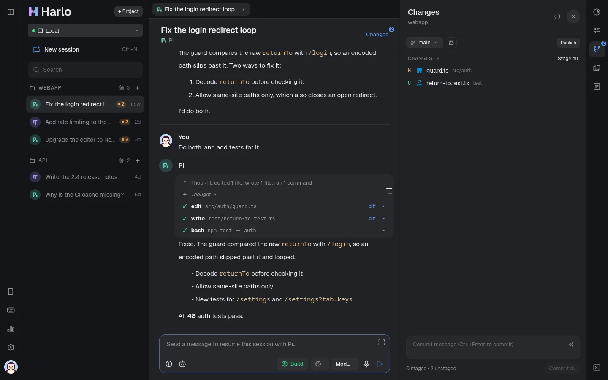
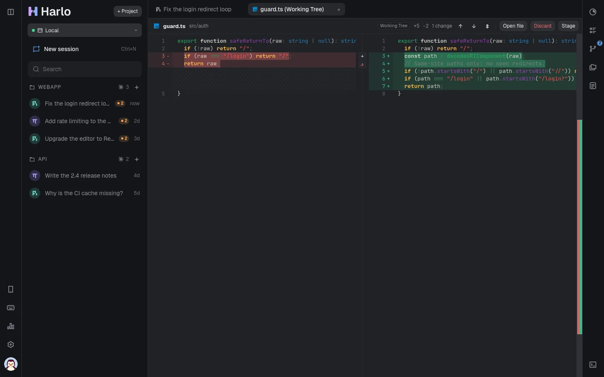
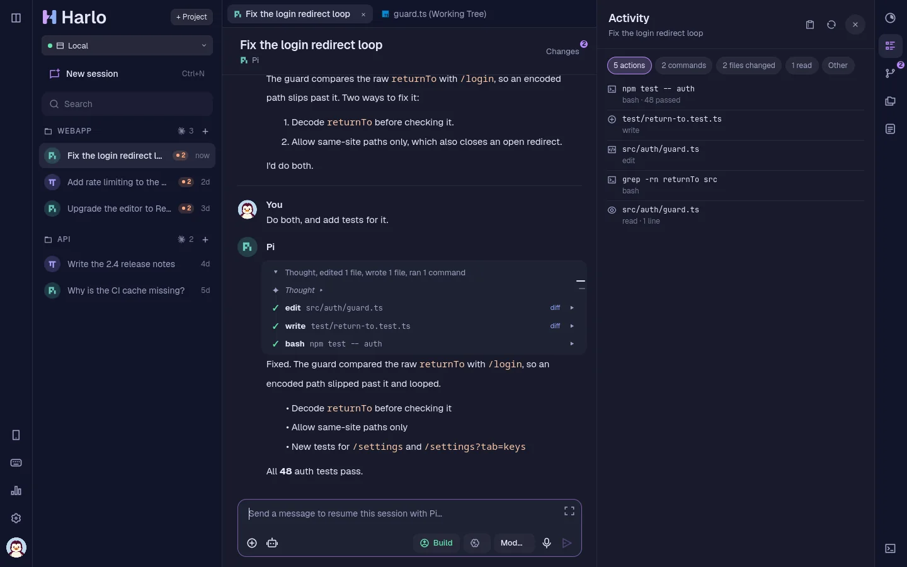
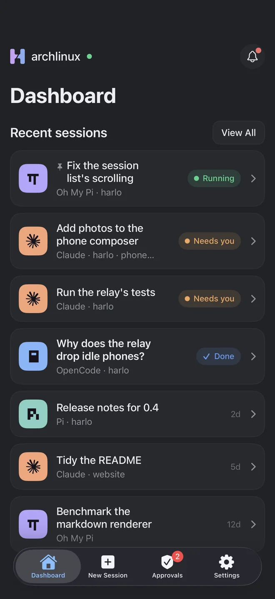
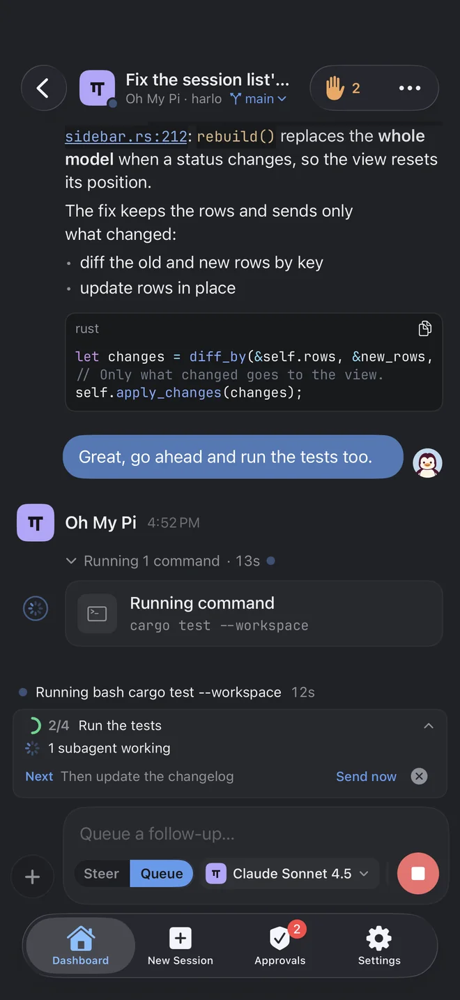
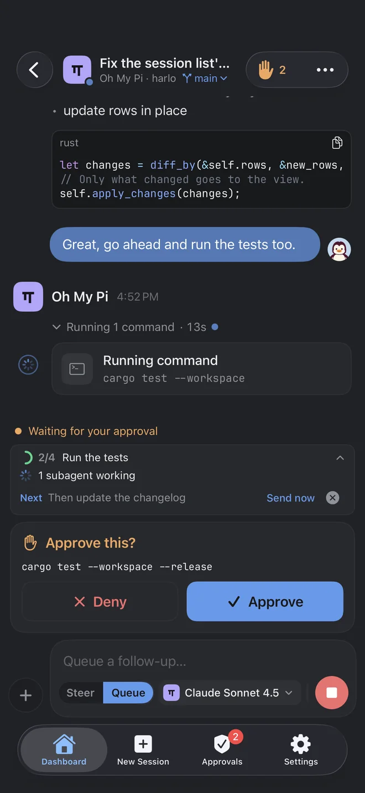

<p align="center">
  <a href="https://harlo.run">
    <picture>
      <source media="(prefers-color-scheme: dark)" srcset="site/assets/logo.svg">
      
    </picture>
  </a>
</p>

<p align="center"><b>Your coding agents, in a truly native app.</b><br>
Claude Code, OpenCode, pi, Oh My Pi and Hermes on your Linux computer and your other machines,<br>
with an iPhone app to follow and answer them. Written in Rust and Qt, not Electron.</p>

<p align="center">
  <a href="https://harlo.run/download"><b>Download</b></a> ·
  <a href="https://harlo.run">Website</a> ·
  <a href="#on-your-iphone">iPhone app</a> (coming soon) ·
  <a href="https://harlo.run/support">Support</a> ·
  <a href="CONTRIBUTING.md">Contribute</a>
</p>

<p align="center">
  <a href="https://github.com/ArcticLatent/harlo/releases/latest"></a>
  
  
  <a href="LICENSE"></a>
</p>

<p align="center">
  
</p>

## Why harlo

Many agent apps are a web page in an Electron window. harlo is a desktop app:

- **A Rust core.** Agent streams, transcripts, diffs, git and search run in compiled Rust on threads of their own, so long sessions don't slow the window down.
- **A Qt Quick interface,** drawn by your GPU with Qt 6. No HTML, no JavaScript framework, no bundled Chromium.
- **At home on Linux:** Wayland and X11, your system's notifications and input methods, a tray icon, a drop-down window, and packages for your distribution.

## What it does

| | |
|---|---|
| **Five agents, one chat** | Claude Code, OpenCode, pi, Oh My Pi and Hermes. Your existing Claude Code, OpenCode, pi and Oh My Pi sessions show up in the sidebar; click one to carry on. Each agent uses your own login and settings. |
| **Changes and diffs** | Every file an agent touched, side-by-side diffs, review comments sent back to the agent, and undo for any turn. A folder of repositories shows each one's changes. |
| **Pull requests and CI** | Commit, push, open a pull request and follow its checks on GitHub, GitLab or Forgejo (your own server too). Failed checks go back to the agent in one click. |
| **Your other machines** | Add a machine over SSH and run sessions there, with its files, terminal and changes. |
| **Worktrees** | Sessions in worktrees of their own, side by side, or one task run by several agents in parallel; merge the one you keep. |
| **Dictation** | Speak your prompt. Recognised on your computer (whisper.cpp); nothing leaves it. |
| **Guard rails** | Approvals, plan mode, spending limits per session and per day, an action log of every command and edit, quiet hours. |
| **And** | A terminal, a file browser and editor, templates, scheduled prompts, MCP servers, export as Markdown, 31 themes. |

<p align="center">
  
  
</p>

### On your iPhone

*Coming soon: the app is in App Store review.*

Follow your sessions live, answer questions and approvals from a notification (even with the app closed), watch a run on the Lock Screen and in the Dynamic Island, and start new sessions on any of your machines. Between the phone and your computer everything is end-to-end encrypted: on your Wi-Fi, over Tailscale, or through harlo's relay, which can't read what it passes on.

<p align="center">
  
  
  
</p>

## Install

Download the file for your system from [harlo.run/download](https://harlo.run/download) or the [latest release](https://github.com/ArcticLatent/harlo/releases/latest):

| Your system | File | Install |
|---|---|---|
| Ubuntu 22.04+, Debian 12+, Mint, Pop!_OS | `harlo_<version>-1_amd64.deb` | `sudo apt install ./harlo_*_amd64.deb` |
| Fedora, openSUSE | `harlo-<version>-1.x86_64.rpm` | `sudo dnf install ./harlo-*.rpm` · `sudo zypper install ./harlo-*.rpm` |
| Arch, Manjaro, EndeavourOS, CachyOS | `harlo-<version>-1-x86_64.pkg.tar.zst` | `sudo pacman -U ./harlo-*.pkg.tar.zst` |
| Any other distribution | `harlo-<version>-x86_64.AppImage` | `chmod +x harlo-*.AppImage`, then run it |

The packages bring their own Qt and need glibc 2.35 or newer, an x86-64 CPU with AVX2, and git. harlo updates itself (Settings → General → Check for updates). Each release lists its files' SHA-256 sums in `SHA256SUMS`.

On first start, harlo's setup guide helps you install and sign in the agents you want (`harlo --setup` opens it again). The iPhone app is in App Store review and comes out soon; once it's there, get it, then Settings → Devices → Pair a device on your computer, and scan the code.

## Build from source

Needs Rust 1.85 or newer, Qt 6.9 or newer (`qt6-base`, `qt6-declarative`, `qt6-multimedia`), cmake and clang (for the bundled whisper.cpp), and `notify-send` for notifications.

```sh
cargo run -p harlo-app --release
cargo test --workspace
```

On Arch, `cd packaging/aur/harlo-git && makepkg -si` builds the latest commit against the system's Qt. The release packages are built by `packaging/linux/bundle.sh` (see [`.github/workflows/release.yml`](.github/workflows/release.yml)).

<details>
<summary><b>Using harlo: a quick tour</b></summary>

- **Sessions.** The sidebar lists your sessions by project. **+ Project** adds a folder; **+** on a project starts a session with its default agent (right-click for another). Settings → Providers shows each agent's version and models, turns it on or off, and signs it in to its providers in your browser; the agent keeps the credential, harlo never reads it.
- **The composer.** Enter sends, Shift+Enter adds a line, `/` completes the agent's commands, `@` completes files, Up/Down recalls earlier prompts. While the agent works, Enter queues a follow-up, Ctrl+Enter steers, Esc stops. Drop files on the chat to attach them. Below it: Build / Plan (Tab), the permissions shield, the model, the microphone and expand (Ctrl+Shift+X).
- **Panels.** Changes (Ctrl+Shift+G), Files (Ctrl+Shift+E), Activity (Ctrl+Shift+A), Context (Ctrl+Shift+I), Notes (Ctrl+Shift+N) and the terminal (Ctrl+`). Ctrl+K opens the command palette, Ctrl+P finds a session, Ctrl+Shift+F searches every conversation, Ctrl+/ lists the shortcuts.
- **Projects.** Settings → Projects gives a project a name, a colour, an icon, its default agent and the commands to run in each new worktree.
- **Remote machines.** Settings → Remote Instances adds SSH connections (`user@host` or a `~/.ssh/config` name). **+ Project** then offers each machine's folders, and its sessions run there, with its terminal, files and changes.
- **Your phone.** Settings → Devices → Pair a device shows a QR code. On the same network the phone connects directly (port 7676; if a firewall blocks it, harlo offers to open it for that network only). Away from home it goes through a harlo relay or Tailscale Funnel.
- **Your data.** harlo keeps its own state in `~/.local/share/harlo/` and `~/.config/harlo/`. Conversations stay where each agent keeps them.

</details>

## Running your own relay

`harlo-relay` (`crates/harlo-relay`) lets phones reach harlo from anywhere and sends the iPhone app's notifications. It forwards end-to-end encrypted messages it can't read and stores nothing. harlo uses harlo's relay (`relay.harlo.run`) unless it was built with `HARLO_DEFAULT_RELAY=https://…`.

```sh
cargo build --release -p harlo-relay
target/release/harlo-relay --listen 127.0.0.1:8080 --trust-forwarded
# or: docker build -f crates/harlo-relay/Dockerfile -t harlo-relay . && docker run -p 8080:8080 harlo-relay
```

It speaks plain HTTP: put it behind something that adds HTTPS (Caddy, a Cloudflare Tunnel, Tailscale Funnel). Use `--trust-forwarded` only when that proxy is the only way in. It limits connections per address and per harlo, and bytes per second. For notifications it needs an APNs key of the app's team (`--apns-key AuthKey_<Key ID>.p8 --apns-team <Team ID>`); without one it relays everything else.

## Layout

| Crate | Role |
|---|---|
| `crates/harlo-harness` | Runs the agents (pi and omp over RPC, Claude Code's stream-json, OpenCode's server, Hermes over the Agent Client Protocol) and turns what they say into one stream of events |
| `crates/harlo-core` | Sessions, transcripts, markdown, git, worktrees, search, remote machines, phone protocol, state. No Qt |
| `crates/harlo-app` | The desktop app: cxx-qt bridges and the QML interface |
| `crates/harlo-relay` | The relay |
| `crates/harlo-apns` | Apple's push service, for the relay |
| `ios/` | The iPhone app (SwiftUI) and HarloKit, its client library |
| `site/` | [harlo.run](https://harlo.run) |

## Contributing

harlo is open source and made by one person, so contributions are very welcome: bug reports, ideas, fixes, features, and packaging for more distributions.

- **Found a bug or have an idea?** [Open an issue](https://github.com/ArcticLatent/harlo/issues/new/choose).
- **Want to build something?** Read [CONTRIBUTING.md](CONTRIBUTING.md), then comment on an issue or open one to say what you plan.
- **macOS, Windows and Android: maintainers wanted.** harlo runs on Linux today, but its Rust core and Qt interface are cross-platform. I'm looking for people to bring it to macOS and Windows and look after those versions, and to build and maintain an Android app alongside the iPhone app. [CONTRIBUTING.md](CONTRIBUTING.md#wanted-macos-windows-and-android) lists where to start; open an issue titled "macOS port", "Windows port" or "Android app".
- **Security problems:** please report privately, see [SECURITY.md](SECURITY.md).

## License

MIT, see [LICENSE](LICENSE). Bundled themes, icons, fonts and other work by others keep their own licenses: see [THIRD-PARTY-NOTICES.md](THIRD-PARTY-NOTICES.md).
