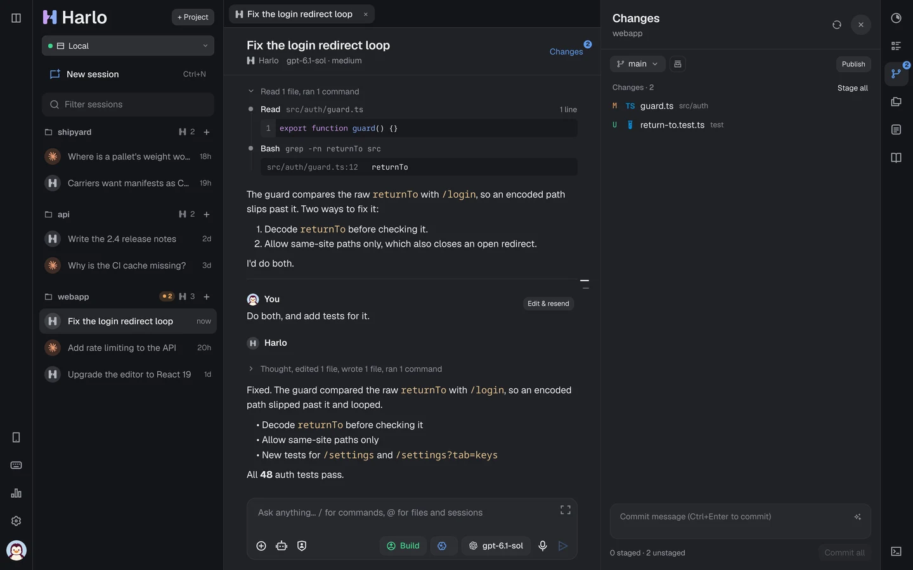
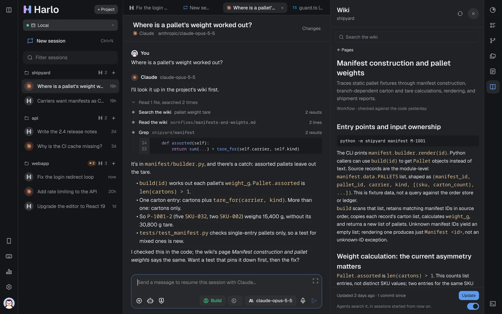
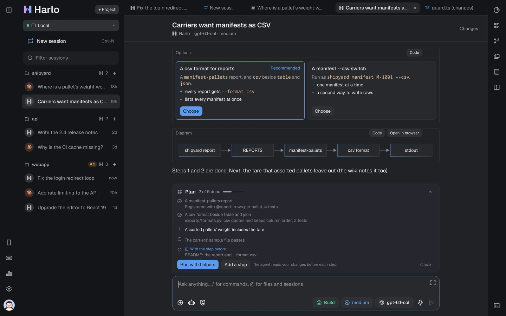
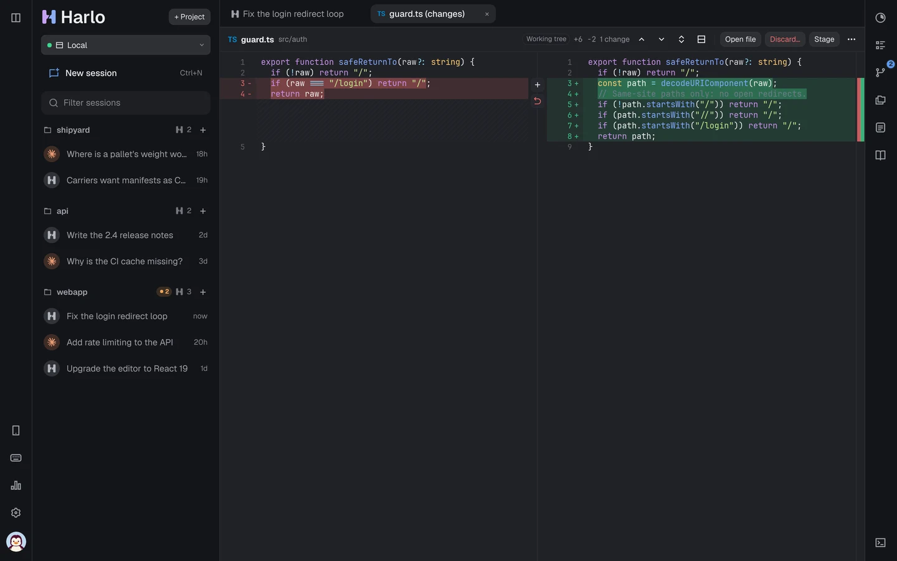
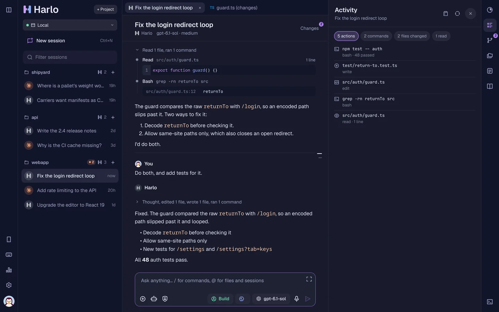
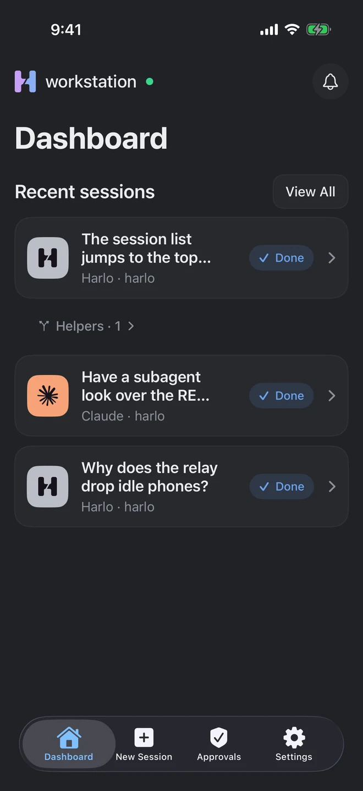
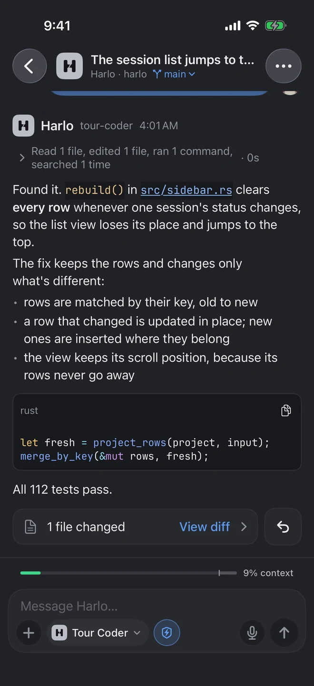
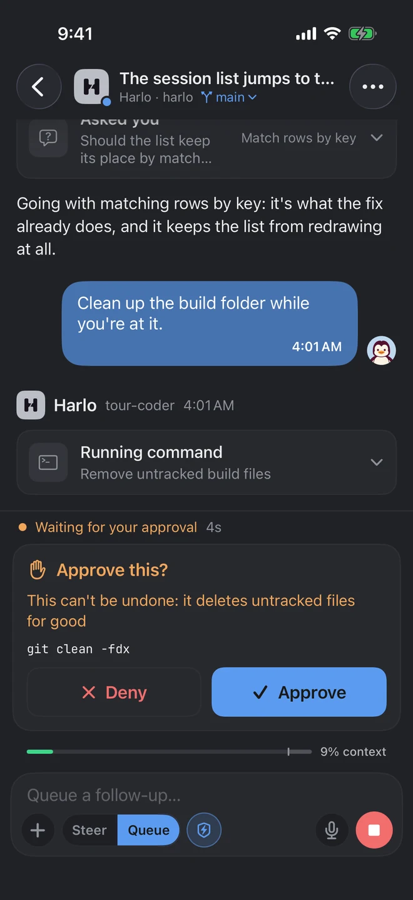
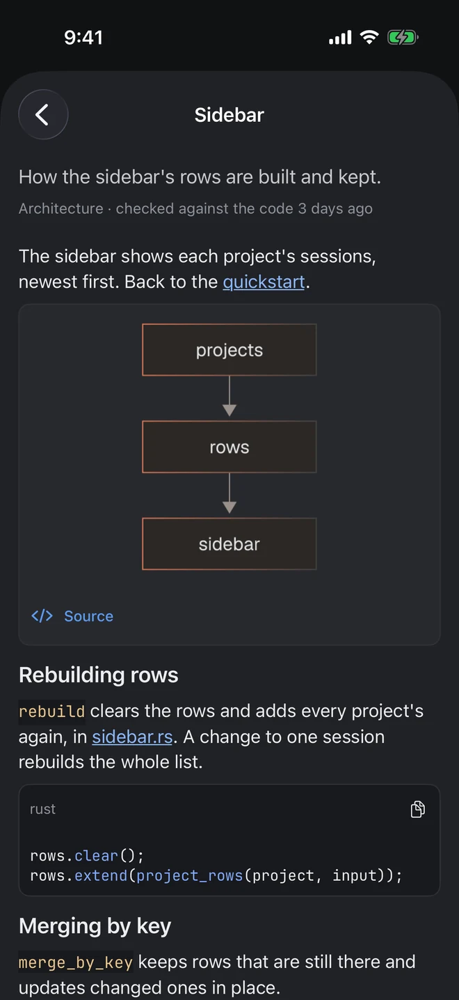

<p align="center">
  <a href="https://harlo.run">
    <picture>
      <source media="(prefers-color-scheme: dark)" srcset="site/assets/logo.svg">
      
    </picture>
  </a>
</p>

<p align="center"><b>Your coding agents, in a truly native app.</b><br>
Harlo, harlo's own agent, and Claude Code on your Linux computer and your other machines,<br>
with your own local models, a wiki of your code, and an iPhone app to follow and answer them.<br>
Written in Rust and Qt, not Electron.</p>

<p align="center">
  <a href="https://harlo.run/download"><b>Download</b></a> ·
  <a href="https://harlo.run">Website</a> ·
  <a href="#on-your-iphone">iPhone app</a> (coming soon) ·
  <a href="https://harlo.run/support">Support</a> ·
  <a href="CONTRIBUTING.md">Contribute</a>
</p>

<p align="center">
  <a href="https://github.com/ArcticLatent/harlo/releases/latest"></a>
  
  
  <a href="LICENSE"></a>
</p>

<p align="center">
  
</p>

## Why harlo

Many agent apps are a web page in an Electron window. harlo is a desktop app:

- **A Rust core.** Agent streams, transcripts, diffs, git and search run in compiled Rust on threads of their own, so a session of 50,000 rows still scrolls smoothly.
- **Drawn by your GPU.** The interface is Qt Quick on Qt 6, and the editor, the diffs and the terminal are drawn by Rust. There's no HTML, no JavaScript framework and no bundled Chromium.
- **At home on Linux:** Wayland and X11, your system's notifications and input methods, a tray icon, a drop-down window, and packages for your distribution.
- **An agent that's careful with tokens.** Harlo, harlo's own agent, does the same work with fewer tokens. See [how it compares](#how-harlo-compares).

## What it does

| | |
|---|---|
| **Two agents, one chat** | **Harlo**, harlo's own agent, works with your ChatGPT plan, an OpenAI key or any OpenAI-compatible server, your own models included. It sees images, searches and reads the web, uses MCP servers and skills, splits work between subagents (each writer in a worktree of its own), and runs its commands in a sandbox. It counts every request's tokens and says what they cost, or that the cost is unknown, never a made-up $0. **Claude Code** uses your own login and settings, and your existing Claude Code sessions show up in the sidebar: click one to carry on. |
| **A wiki of your code** | harlo comes with [OpenWiki](https://github.com/langchain-ai/openwiki). **Create wiki** has your agent write a linked wiki of the repository (its architecture, workflows and the reasons behind them), with every fact tied to the lines of code it came from. Your agents then search it and read only the sections they need. The Wiki panel lists the pages, reads them with their diagrams and sources, searches them and draws them as a graph. It also shows how far behind the code the wiki is, and Update rewrites only the pages whose code changed. |
| **Plans and helpers** | For a bigger task the agent writes a plan you can edit, and works through it step by step. **Run with helpers** gives each step a session of its own, steps that don't depend on each other at the same time in worktrees, and each finished step is reviewed by another agent. An agent can also offer to split work between helpers; you decide. |
| **Diagrams, choices and mockups** | Agents draw Mermaid diagrams, which harlo shows as pictures. A choice between approaches comes as cards with their pros and cons and a Choose button. A UI change comes as a mockup harlo renders, before and after. |
| **Changes and diffs** | Every file an agent touched, side-by-side diffs, review comments sent back to the agent, and undo for any turn. A folder of repositories shows each one's changes. |
| **Pull requests and CI** | Commit, push, open a pull request and follow its checks on GitHub, GitLab or Forgejo (your own server too). Failed checks go back to the agent in one click. |
| **Your other machines** | Add a machine over SSH and run sessions there as you would here: its files, terminal, changes, worktrees, sign-ins, models, wikis and plans. |
| **Your own models** | Settings → Model servers sets up llama.cpp, Ollama, vLLM, Strata, Basalt or NInfer for your graphics card, downloads a model that fits and adds it to your agents. On this computer or on another machine (a GPU box, a NAS; x86-64 or ARM), each machine's agents can use the other's servers through SSH, and a stopped server starts before your message. |
| **Plan limits and spending** | Your Claude and ChatGPT plan's limits as they change, on each machine, a notification when one is used up and when it resets, and Stop and continue at the reset. Spending limits per session and per day. The context bar marks where each agent compacts. |
| **Worktrees** | Sessions in worktrees of their own, side by side, or one task run by several agents in parallel; merge the one you keep. |
| **Dictation** | Speak your prompt. Recognised on your computer (whisper.cpp); nothing leaves it. |
| **Guard rails** | Approvals, plan mode, an action log of every command and edit, quiet hours. Harlo's commands run in a sandbox (bubblewrap) that can change only the project, /tmp and tool caches and can't see your keys and sign-ins. |
| **And** | A terminal, a file browser and editor with find and replace, an image viewer, pictures in the chat, search across every conversation, templates, scheduled prompts, MCP servers, hand-offs and second opinions between agents, export as Markdown, and 31 themes. |

<p align="center">
  
  
</p>
<p align="center">
  
  
</p>

## How Harlo compares

Harlo, pi and opencode on the same 26 coding tasks (fixing bugs across files, refactoring, reading long logs, splitting work between subagents), with the same model and reasoning (gpt-6.1-sol, medium). Totals over the 25 tasks all three can run:

| | Harlo | pi | opencode |
|---|---|---|---|
| Tasks passed | 25 of 25 | 24 of 25 | 25 of 25 |
| Input tokens | 807k | 1,175k | 2,702k |
| Not from cache | 220k | 247k | 520k |
| Output tokens | 25.2k | 22.0k | 32.1k |
| Time | 14 min | 15 min | 15 min |

On these tasks Harlo sent less than a third of opencode's input and less than pi's, and passed every one (it passed the 26th too, which pi can't run). Measured on 12 November 2026 with harlo-agent at b6896427, pi 1.5.2 and opencode 2.2.5; your numbers will vary with the model and the task.

### On your iPhone

*Coming soon to the App Store.*

Follow your sessions live, answer questions and approvals from a notification (even with the app closed), and watch a run on the Lock Screen and in the Dynamic Island. Read and search a project's wiki, follow a plan and its helpers, look through changes, files and pictures, and start new sessions on any of your machines. Widgets show your sessions and your plan's limits. Between the phone and your computer everything is end-to-end encrypted: on your Wi-Fi, over Tailscale, or through harlo's relay, which can't read what it passes on.

<p align="center">
  
  
  
  
</p>

## Install

Download the file for your system from [harlo.run/download](https://harlo.run/download) or the [latest release](https://github.com/ArcticLatent/harlo/releases/latest):

| Your system | File | Install |
|---|---|---|
| Ubuntu 22.04+, Debian 12+, Mint, Pop!_OS | `harlo_<version>-1_amd64.deb` | `sudo apt install ./harlo_*_amd64.deb` |
| Fedora, openSUSE | `harlo-<version>-1.x86_64.rpm` | `sudo dnf install ./harlo-*.rpm` · `sudo zypper install ./harlo-*.rpm` |
| Arch, Manjaro, EndeavourOS, CachyOS | `harlo-<version>-1-x86_64.pkg.tar.zst` | `sudo pacman -U ./harlo-*.pkg.tar.zst` |
| Any other distribution | `harlo-<version>-x86_64.AppImage` | `chmod +x harlo-*.AppImage`, then run it |

The packages bring their own Qt and OpenWiki (with the Node.js it runs on), and need glibc 2.35 or newer, an x86-64 CPU with AVX2, and git. harlo updates itself (Settings → General → Check for updates). Each release lists its files' SHA-256 sums in `SHA256SUMS`.

On first start, harlo's setup guide helps you install and sign in the agents you want (`harlo --setup` opens it again). Once the iPhone app is in the App Store, get it, then Settings → Devices → Pair a device on your computer, and scan the code.

## Build from source

Needs Rust 1.85 or newer, Qt 6.9 or newer (`qt6-base`, `qt6-declarative`, `qt6-multimedia`), cmake and clang (for the bundled whisper.cpp), and `notify-send` for notifications.

```sh
cargo run -p harlo-app --release
cargo build -p harlo-core --release --bin harlo-engines --no-default-features   # model servers on other machines
packaging/openwiki/fetch.sh target/openwiki                                       # the wiki: OpenWiki and its Node.js
cargo test --workspace
```

On Arch, `cd packaging/aur/harlo-git && makepkg -si` builds the latest commit against the system's Qt. The release packages are built by `packaging/linux/bundle.sh` (see [`.github/workflows/release.yml`](.github/workflows/release.yml)).

<details>
<summary><b>Using harlo: a quick tour</b></summary>

- **Sessions.** The sidebar lists your sessions by project; drag a project to move it. **+ Project** adds a folder; **+** on a project starts a session with its default agent (right-click for another). Settings → Providers shows each agent's version and models, turns it on or off, and signs it in to its providers in your browser; the agent keeps the credential, harlo never reads it.
- **The composer.** Enter sends, Shift+Enter adds a line, `/` completes the agent's commands, `@` completes files and past sessions, Up/Down recalls earlier prompts. While the agent works, Enter queues a follow-up, Ctrl+Enter steers, Esc stops. Drop files or pictures on the chat to attach them. Below it: Build / Plan (Tab), the permissions shield, the model, the microphone and expand (Ctrl+Shift+X).
- **Panels.** Changes (Ctrl+Shift+G), Files (Ctrl+Shift+E), Activity (Ctrl+Shift+A), Context (Ctrl+Shift+I), Notes (Ctrl+Shift+N), Wiki (Ctrl+Shift+K) and the terminal (Ctrl+`). Ctrl+K opens the command palette, Ctrl+P finds a session, Ctrl+Shift+F searches every conversation, Ctrl+F finds in the one shown, Ctrl+/ lists the shortcuts.
- **Projects.** Settings → Projects gives a project a name, a colour, an icon, its default agent, its wiki setting and the commands to run in each new worktree.
- **The wiki.** In the Wiki panel, **Create wiki** starts a session that writes it; its changes land in Changes for you to review and commit, like any other. Once a project has a wiki, its sessions get the wiki's search and read tools unless you switch Wiki off for the project. After merged work changes what the wiki describes, harlo offers to update it.
- **Remote machines.** Settings → Remote Instances adds SSH connections (`user@host` or a `~/.ssh/config` name). The instance menu at the top of the sidebar switches between this computer and each machine, and connects or disconnects one. **+ Project** then offers each machine's folders (with New folder), and its sessions run there, with its terminal, files and changes. An agent there signs in from the model menu (**Sign in on <machine>**).
- **Model servers.** Settings → Model servers: **Set up a local model…** for this computer, **Set up a model on <machine>…** for each connected machine. harlo shows what fits the machine's card and memory, installs the engine, downloads the model, starts it and tests it. Tick the agents that should use it, on that machine or (through SSH) here. On another machine, harlo runs a small helper of its own (`harlo-engines`, in `~/.cache/harlo` there) for the setup.
- **Your phone.** Settings → Devices → Pair a device shows a QR code. On the same network the phone connects directly (port 7676; if a firewall blocks it, harlo offers to open it for that network only). Away from home it goes through a harlo relay or Tailscale Funnel.
- **Your data.** harlo keeps its own state in `~/.local/share/harlo/` and `~/.config/harlo/`. Conversations stay where each agent keeps them.

</details>

## Running your own relay

`harlo-relay` (`crates/harlo-relay`) lets phones reach harlo from anywhere and sends the iPhone app's notifications. It forwards end-to-end encrypted messages it can't read and stores nothing. harlo uses harlo's relay (`relay.harlo.run`) unless it was built with `HARLO_DEFAULT_RELAY=https://…`.

```sh
cargo build --release -p harlo-relay
target/release/harlo-relay --listen 127.0.0.1:8080 --trust-forwarded
# or: docker build -f crates/harlo-relay/Dockerfile -t harlo-relay . && docker run -p 8080:8080 harlo-relay
```

It speaks plain HTTP: put it behind something that adds HTTPS (Caddy, a Cloudflare Tunnel, Tailscale Funnel). Use `--trust-forwarded` only when that proxy is the only way in. It limits connections per address and per harlo, and bytes per second. For notifications it needs an APNs key of the app's team (`--apns-key AuthKey_<Key ID>.p8 --apns-team <Team ID>`); without one it relays everything else.

## Layout

| Crate | Role |
|---|---|
| `crates/harlo-harness` | Runs the agents (Harlo over its RPC, Claude Code's stream-json) and turns what they say into one stream of events |
| `crates/harlo-agent` | Harlo, harlo's own agent (`harlo-agent`): the model loop, its tools, the sandbox, MCP and subagents |
| `crates/harlo-core` | Sessions, transcripts, markdown, git, worktrees, search, plans, the wiki (OpenWiki), remote machines, model servers, phone protocol, state. No Qt. Its `harlo-engines` program sets up and runs model servers on other machines |
| `crates/harlo-code` | The text and terminal views drawn by Rust: the editor, both sides of a diff, the terminal |
| `crates/harlo-app` | The desktop app: cxx-qt bridges and the QML interface |
| `crates/harlo-relay` | The relay |
| `crates/harlo-apns` | Apple's push service, for the relay |
| `crates/harlo-update-signing`, `crates/harlo-manifest-signer` | The signature on harlo's update manifest, and the release tool that signs it |
| `packaging/` | The Linux packages, the AUR recipes and the pinned OpenWiki |
| `ios/` | The iPhone app (SwiftUI), its widgets and HarloKit, its client library |
| `site/` | [harlo.run](https://harlo.run) |

## Contributing

harlo is open source and made by one person, so contributions are very welcome: bug reports, ideas, fixes, features, and packaging for more distributions.

- **Found a bug or have an idea?** [Open an issue](https://github.com/ArcticLatent/harlo/issues/new/choose).
- **Want to build something?** Read [CONTRIBUTING.md](CONTRIBUTING.md), then comment on an issue or open one to say what you plan.
- **macOS, Windows and Android: maintainers wanted.** harlo runs on Linux today, but its Rust core and Qt interface are cross-platform. I'm looking for people to bring it to macOS and Windows and look after those versions, and to build and maintain an Android app alongside the iPhone app. [CONTRIBUTING.md](CONTRIBUTING.md#wanted-macos-windows-and-android) lists where to start; open an issue titled "macOS port", "Windows port" or "Android app".
- **Security problems:** please report privately, see [SECURITY.md](SECURITY.md).

## License

MIT, see [LICENSE](LICENSE). Bundled themes, icons, fonts and other work by others keep their own licenses: see [THIRD-PARTY-NOTICES.md](THIRD-PARTY-NOTICES.md). The packages also carry [OpenWiki](https://github.com/langchain-ai/openwiki) (MIT) and Node.js, with their licenses and those of OpenWiki's packages.
