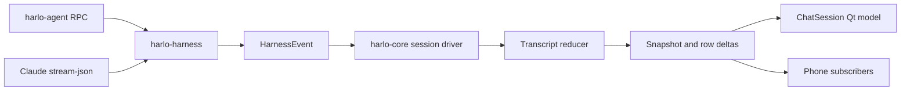

# Sessions, persistence, and desktop presentation

## Ownership boundaries

Harlo separates process protocols, application state, and rendering:



`harlo-harness` owns launch/transport and translates agents into `HarnessEvent`. Harlo uses JSONL RPC; the Claude adapter accepts the harness command vocabulary and translates Claude's stream-json messages, tools, approvals, and questions. `harlo-core` owns session driving and transcript reduction without Qt. `harlo-app` bridges that state into QML rather than implementing a second agent protocol.

The desktop's `registry.rs` retains shared `Arc<SessionHandle>` entries for the workspace and attached chat views. A view is a subscriber, not the owner of an agent's progress. See [agent execution](../concepts/agent-execution-and-safety.md) for the process on the other end of the pipe.

## A prompt through the session driver

`SessionHandle` queues controls onto a Tokio channel: prompts, cancellation, answers, requests, reloads, and subscriptions. `spawn` starts a harness immediately; `open_saved` displays its saved conversation first and starts a process only when a command needs one. Dropping the last handle stops the harness.

A subscriber receives a snapshot before deltas. During streaming, the driver batches updates on a 100 ms interval rather than asking the UI to redraw for every token. The transcript reducer produces flat rows and a row diff, allowing a changed row to update without resetting the entire list. Session states distinguish loading, offline saved content, starting, idle, busy, and exited; an offline conversation is not a running agent.

Prompts return false when a session or daily spending hold is active, so callers must not assume every send was accepted. Harness exits become session state and notices rather than leaving a view permanently busy.

Before a new turn, the driver takes its undo snapshot asynchronously and holds prompts while reporting `Preparing(true)`, including to newly attached subscribers. Stop remains responsive: it removes all held prompts, invalidates the snapshot completion token, and emits `Unsent(Vec<Unsent>)` in send order. Each returned message retains wire text, images, send mode, and optional `Typed` words and attachment paths. A late snapshot completion cannot send the cancelled prompts. Steering during a busy turn and `/btw` do not start this new-turn snapshot path.

Recovery also covers a harness that cannot start: the unsent prompt and any remaining held prompts are returned with a transcript notice. `SessionSink::composes` distinguishes desktop/phone composers from passive watchers. If no composing subscriber is attached, the driver keeps returned messages in memory until the first composing subscriber arrives, then drains them into that subscriber's initial updates. A later composer does not receive that backlog again; this is live-session state, not durable draft storage.

The sender supplies original words and attachment paths through `prompt_typed`, so recovery no longer depends on matching returned prompts to a view's recent sends. Without typed metadata, `Unsent::words` strips the trailing plan note and leading photo placeholders. The desktop saves supported inline pictures as content-named files when no original attachment paths exist, including pictures sent from the phone. Restored messages go above any new composer draft; attachments are merged without duplicates. This preserves multiple cancelled sends and attachment-only messages instead of restoring only the last text.

Session metadata carries `cost_kind` separately from numeric cost, distinguishing plan/local usage, priced usage, partly known cost, and unknown cost. The context report forwards this classification rather than interpreting a numeric zero as evidence that usage was free.

## Long history is streamed, settled, and paged

Opening a saved conversation does not require loading every message into one vector. `harlo-harness::store::stream_saved_for` passes current-branch messages to the session one at a time. The session builds transcript rows and a context tally as messages arrive, and every 4,096 messages materializes rows and pages eligible older settled replies. The stream path works for Harlo JSONL and Claude's cached reader; when a remote session is opened, Harlo first copies what is available locally and reports any missing tail rather than treating an incomplete copy as a complete history.

Opening a saved session fixes the history read at the file's initial byte length. Events arriving from a running agent meanwhile are retained and replayed over the loaded transcript, so a new prompt or reply is not lost or overwritten by the older history read. For a long opening, cached rows and then the latest rows can be shown before the full row list is built. Claude's harness likewise permits a prompt to be sent while resume history is being read, but history-dependent requests such as `get_messages` wait until that read finishes; an unreadable history is an error, not an empty conversation or partial substitute. Remote history uses the available local copy's size as its boundary and surfaces a missing-tail notice.

The transcript deliberately keeps a short mutable tail in memory: only completed assistant replies whose tool results have arrived are settled. Settling releases duplicate source text, thinking, command arguments, and tool output when their rendered rows already hold what is needed. Paging then moves long row payloads and settled message blocks to a process-owned cache file, preserving lightweight row identity and metadata for ordering, search, and list updates. Page-out considers content beyond the retained row window and also pages older settled output when the latest retained text exceeds 8 MiB; each row payload must be at least 256 bytes to be written separately. A page-file failure leaves data resident in memory, so correctness degrades to higher memory use rather than losing transcript text. A paged row is read back when shown; the desktop model keeps at most 160 fully materialized rows in its own LRU cache. Page files are removed when their last references go away, and startup cleanup sweeps files left by dead processes.

The context/activity report is accumulated incrementally alongside transcript loading. It keeps totals and the latest 300 activity rows, while its action log retains the newest 2,000 actions but still counts all calls. Tool calls are joined to results by call ID, so pending actions can be shown as still running and failed reads/edits are removed from the aggregate path sets. Action classification normalizes common names across Claude and Harlo tools and excludes todo updates. Markdown export also streams saved messages through two passes: one locates tool results, the next writes user/assistant turns and compact tool summaries without retaining a whole rendered export in memory.

These are bounded-retention strategies, not a fixed ceiling on total process memory: current rows, indexes, tallies, Qt caches, and active messages still occupy memory. The memory tests assert relative allocation bounds for representative generated logs rather than measuring a complete application's resident set.

## Crossing into Qt safely

`ChatSession` is a cxx-qt `QAbstractListModel`. Its `QtSink` queues updates onto the Qt thread. Each binding has a generation counter: queued updates from an old binding are ignored after switching sessions. Rebinding and dropping the model unsubscribe the old sink, while the registry can keep the session itself alive.

This is the extension seam for desktop presentation: change row roles and QML consumers here, but keep event normalization in the harness and state reduction in core. The code editor has a similar split: `harlo-code` lays out and draws visible code in Rust without Qt; the app's CodeView presents its image and forwards input.

Transcript Markdown uses `render_rows` to divide long code blocks into 150-line pieces and tables into 100-row pieces, rather than creating one enormous delegate. Continuation rows carry their part, first line, and first-row identity; the first code row retains the complete code for copying. Table pieces share column widths and show the header once. The still-streaming final piece is not cached; finished pieces can be reused. Ordinary `render`, used outside this transcript path, still returns whole blocks.

Code splitting removes only the separator newline from nonfinal pieces. The final piece retains its trailing blank lines; joining pieces with one newline therefore preserves the complete code, including blank lines at piece boundaries and at the end. This matters both for first-row copying and for the phone's reconstruction of highlighted HTML.

For the phone-specific display and copy limits, follow [phone transcript windows](../integrations/phone-and-relay.md); desktop row splitting and transport truncation are separate concerns.

## Plugins and image viewing stay at the app boundary

When a user's own prompt starts with `/plugin`, `/plugins`, or `/marketplace`, the session driver intercepts it rather than passing it to the agent. Core runs `claude plugin …` in the session's working directory, locally or through the session's remote host, and returns a transcript notice with bounded plain-text output. A successful install, remove, enable, disable, update, or marketplace change restarts the agent once idle so Claude Code can reload plugins and Harlo can refresh its plugin-provided skills and slash-command list. Listing and informational commands do not trigger a restart. Agent-authored text that happens to begin with these words is not intercepted: the prompt must be marked as typed by the user.

The desktop image viewer is separate from phone serialization. `ImageView`, `ImageThumb`, and the `Images` singleton decode on worker threads and share decoded pixels through a bounded cache; views upload pixels for GPU rendering, so zoom and pan do not repeatedly decode. Large stills use a screen-sized copy until zoom requires the original pixels, while long animations stream frames as they play. Closing the last image view drops the full-image cache; thumbnails have their own memory and disk caches. These cache budgets limit retained decoded images, not all process memory.

## Persistence is deliberately split

| Data | Owner and storage |
| --- | --- |
| Projects, session flags, worktrees, run lanes, schedules, settings | Core SQLite database, normally `$XDG_DATA_HOME/harlo/harlo.db` or `~/.local/share/harlo/harlo.db` |
| Harlo conversation history | Agent JSONL files under `$XDG_DATA_HOME/harlo-agent/sessions/--<abs-path>--/` |
| Claude conversation history | Claude's own session files, read by the Claude adapter |
| Active transcript and subscriptions | In-memory session driver and shared handles |
| Last-listed slash commands | Small cache keyed by agent, remote host, and working directory beside the session report cache; used while an opened session's agent has not started |

The database is not a replacement transcript store. The harness store builds sidebar session summaries from session files, reading only the head and tail of large Harlo logs. Display titles prefer the saved name, then the first prompt, then an untitled placeholder. Database initialization enables SQLite WAL mode.

Harness children are isolated into their own process groups. Ordinary stop closes stdin and allows up to three seconds for exit before killing the child; desktop shutdown sends `SIGTERM` to tracked groups, waits briefly, then sends `SIGKILL` to remaining groups. This also cleans up descendants that an agent launched, rather than leaving them detached when Harlo exits.

When diagnosing missing history, first separate discovery of the agent's file from the app's project/visibility metadata. When diagnosing stale rendering, compare the reducer's rows with the subscriber snapshot before changing the protocol adapter.

## Searching without blocking presentation

Agent `list_sessions` queries are deferred from the workspace UI handler to orchestration's background completion path. The shared search reader performs the index query there; results return to the Qt thread to join workspace session metadata, filter by folder (unless `everywhere`), and exclude the calling session. The response contains at most eight sessions with up to two passages each.

The desktop search dialog likewise queries off-thread. It records the newest query generation and skips an older waiting query after acquiring the reader lock, avoiding a backlog of obsolete searches. This does not cancel a query already executing. Slow-search behavior can be exercised with `HARLO_TEST_SLOW_SEARCH_MS`; the QML session-search scenario checks that the window continues drawing.

Local Harlo history can now be indexed incrementally as well as local Claude history. The Harlo reader resumes only across complete JSONL lines when the saved tail still matches and new entries continue the previous leaf. Branching, rewriting, or incompatible resume state causes a full active-branch read instead. The search index tracks message row IDs separately so replacement and deletion do not require scanning all FTS content, and backfills this mapping for older indexes.

An indexed file that is still listed but temporarily unreadable is not treated as an empty conversation. Local read failures and failed remote copies return `None`; the index preserves existing hits and the previous file stamp, throttles retries, and replaces content only after a successful read. Files absent from the supplied file list still follow the ordinary deletion path.

## Finished wiki sessions and approval presentation

Finished wiki sessions use a separate **Wiki** shelf after **Settled**, with independent expansion state. The workspace marks an idle wiki session with the `wiki` settlement reason, deferring settlement while it is the active view or lacks a saved file. Disabled session settling, pinning, and archiving remain respected. This is session organization, not proof that the durable [OpenWiki run](../integrations/openwiki.md) completed successfully.

While an OpenWiki plan-submission call streams, transcript progress stays blank until `pages` arrives as an array. An empty array is then reported as “no pages to change,” rather than as a zero-page plan. This avoids presenting a partial tool payload as a completed plan count.

Approval messages marked as Markdown are rendered through the core Markdown renderer into prose and code blocks. The request body scrolls within a bounded region so long plans do not push the answer controls out of view; ordinary non-Markdown requests retain plain text presentation.

## Workspace and transcript controls

Settings pages are thin views over workspace-owned state rather than alternate stores. The Projects page selects a project and sends edits for its name, icon, and theme-derived color through `Workspace`; its per-project controls also configure which provider new sessions use. The Providers page distinguishes local agents from agents installed on the selected remote instance: remote discovery, installation, updates, and sign-in status belong to that host, while the enabled-agent choice is shared across instances. Appearance settings similarly call workspace theme/look controls, and expose whether glass effects are unavailable under software rendering. These controls change application preferences; they do not change an agent's own login or machine-local provider configuration.

`ToolCard` is the transcript's expandable representation of one tool call. It combines the call/result state with the shared code-view parser: edits and writes show a diff preview, reads and command output can render numbered source, and opening a long output reveals more without discarding its location. A card can expose an approval state, attached images, and subagent associations; it is presentation over transcript/session data, not the tool executor or approval authority.

The task workflow UI is a separate feature from the shared orchestration plan dock. Its settings page edits reusable definitions, while a running `WorkflowCard` observes the workflow run associated with a session and offers run-level pause, resume, stop, and log expansion. Definition edits do not rewrite the copy already captured by an active run; see [user-defined workflows](../workflows/user-defined-workflows.md) for the lifecycle and retry rules.

## Focused verification

- `finished_wiki_runs_have_a_shelf_of_their_own` checks separate Wiki shelf grouping and expansion.
- `a_message_that_couldnt_be_sent_comes_back` checks launch-failure recovery with only a watcher attached, first-composer delivery, and no duplicate backlog for a later composer. `a_file_not_readable_now_keeps_its_hits` checks failed-read preservation, retry throttling, and successful replacement.
- `a_message_sent_while_a_long_session_loads_shows_at_once` checks that a prompt sent during saved-history loading is visible without waiting for the file scan and is retained with the loaded conversation. Claude's `a_resumed_session_shows_what_you_send_before_its_history_is_read` checks the corresponding harness boundary and that history-dependent state is complete before it is returned.
- `every_unsent_message_comes_back_with_its_files` checks ordered recovery, repeated text, attachment-only sends, and phone-origin text. The QML stop-before-send scenario also checks preservation of a newer draft and that cancelled messages never reach the model after the delayed snapshot finishes.
- `a_harlo_session_is_read_on_while_it_goes_on_and_whole_when_it_branches` covers append, partial-line, branch, and rewrite behavior; `an_index_from_before_its_row_table_still_forgets` covers old-index migration and deletion.
- Markdown's long-code/table and streaming-cache tests, together with `a_long_code_block_is_rows_of_one_card`, verify continuation boundaries and whole-block copying.
- `a_long_session_shows_its_last_report_while_it_opens` checks that a cached report is available during loading and replaced with the recomputed report afterward. Transcript tests cover paging and read-back (`paged_replies_read_back_whole`, `rows_past_their_text_budget_page_out_however_few`); `crates/harlo-core/tests/memory.rs` checks streaming session/branch reads, Claude incremental reads, and that repeated row materialization does not duplicate tool output.

- `session::tests::demo_run_reaches_subscribers` exercises idle → busy → idle, resulting user/tool/code rows, and equality of a late subscriber's snapshot with accumulated deltas.
- `idle_session_restarts_when_used_again` verifies that an idle agent can stop to reload configuration and restart on the next prompt.
- `plugin_commands_only_from_you` checks that only explicitly user-typed plugin commands are intercepted. `crates/harlo-core/src/plugins.rs` also tests command parsing, notices, output cleanup/bounds, and whether a successful operation changes installed state.
- The image viewer's worker/cache behavior is implemented in `crates/harlo-app/src/image_view.rs`; phone picture serialization has separate size/format coverage on the phone page.
- Harness framing tests cover chunk reassembly and rejection of out-of-order chunks.

Run a focused test without the optional dictation dependency:

```sh
cargo test -p harlo-core --no-default-features demo_run_reaches_subscribers
cargo test -p harlo-harness framing
```

These are suggested checks, not a claim that they were run while generating this wiki. Phone consumers of the same state are described in [phone and relay](../integrations/phone-and-relay.md).
