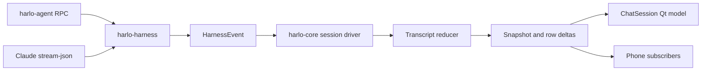

# Sessions, persistence, and desktop presentation

## Ownership boundaries

Harlo separates process protocols, application state, and rendering:



`harlo-harness` owns launch/transport and translates agents into `HarnessEvent`. Harlo uses JSONL RPC; the Claude adapter accepts the harness command vocabulary and translates Claude's stream-json messages, tools, approvals, and questions. `harlo-core` owns session driving and transcript reduction without Qt. `harlo-app` bridges that state into QML rather than implementing a second agent protocol.

The desktop's `registry.rs` retains shared `Arc<SessionHandle>` entries for the workspace and attached chat views. A view is a subscriber, not the owner of an agent's progress. See [agent execution](../concepts/agent-execution-and-safety.md) for the process on the other end of the pipe.

## A prompt through the session driver

`SessionHandle` queues controls onto a Tokio channel: prompts, cancellation, answers, requests, reloads, and subscriptions. `spawn` starts a harness immediately; `open_saved` displays its saved conversation first and starts a process only when a command needs one. Dropping the last handle stops the harness.

A subscriber receives a snapshot before deltas. During streaming, the driver batches updates on a 100 ms interval rather than asking the UI to redraw for every token. The transcript reducer produces flat rows and a row diff, allowing a changed row to update without resetting the entire list. Session states distinguish loading, offline saved content, starting, idle, busy, and exited; an offline conversation is not a running agent.

Prompts return false when a session or daily spending hold is active, so callers must not assume every send was accepted. Harness exits become session state and notices rather than leaving a view permanently busy.

Before a new turn, the driver takes its undo snapshot asynchronously and holds prompts while reporting `Preparing(true)`, including to newly attached subscribers. Stop remains responsive: it removes all held prompts, invalidates the snapshot completion token, and emits `Unsent(Vec<String>)` with their text in send order. A late snapshot completion cannot send the cancelled prompts. Steering during a busy turn and `/btw` do not start this new-turn snapshot path.

The desktop matches returned prompts to recent sends to recover the original typed text and attachments, rather than exposing injected file context or the plan-mode note. Unmatched text, such as a prompt sent from the phone, is returned with the trailing plan note removed. Restored messages go above any new composer draft; attachments are merged without duplicates. This preserves multiple cancelled sends and attachment-only messages instead of restoring only the last text.

Session metadata carries `cost_kind` separately from numeric cost, distinguishing plan/local usage, priced usage, partly known cost, and unknown cost. The context report forwards this classification rather than interpreting a numeric zero as evidence that usage was free.

## Crossing into Qt safely

`ChatSession` is a cxx-qt `QAbstractListModel`. Its `QtSink` queues updates onto the Qt thread. Each binding has a generation counter: queued updates from an old binding are ignored after switching sessions. Rebinding and dropping the model unsubscribe the old sink, while the registry can keep the session itself alive.

This is the extension seam for desktop presentation: change row roles and QML consumers here, but keep event normalization in the harness and state reduction in core. The code editor has a similar split: `harlo-code` lays out and draws visible code in Rust without Qt; the app's CodeView presents its image and forwards input.

## Persistence is deliberately split

| Data | Owner and storage |
| --- | --- |
| Projects, session flags, worktrees, run lanes, schedules, settings | Core SQLite database, normally `$XDG_DATA_HOME/harlo/harlo.db` or `~/.local/share/harlo/harlo.db` |
| Harlo conversation history | Agent JSONL files under `$XDG_DATA_HOME/harlo-agent/sessions/--<abs-path>--/` |
| Claude conversation history | Claude's own session files, read by the Claude adapter |
| Active transcript and subscriptions | In-memory session driver and shared handles |

The database is not a replacement transcript store. The harness store builds sidebar session summaries from session files, reading only the head and tail of large Harlo logs. Display titles prefer the saved name, then the first prompt, then an untitled placeholder. Database initialization enables SQLite WAL mode.

When diagnosing missing history, first separate discovery of the agent's file from the app's project/visibility metadata. When diagnosing stale rendering, compare the reducer's rows with the subscriber snapshot before changing the protocol adapter.

## Searching without blocking presentation

Agent `list_sessions` queries are deferred from the workspace UI handler to orchestration's background completion path. The shared search reader performs the index query there; results return to the Qt thread to join workspace session metadata, filter by folder (unless `everywhere`), and exclude the calling session. The response contains at most eight sessions with up to two passages each.

The desktop search dialog likewise queries off-thread. It records the newest query generation and skips an older waiting query after acquiring the reader lock, avoiding a backlog of obsolete searches. This does not cancel a query already executing. Slow-search behavior can be exercised with `HARLO_TEST_SLOW_SEARCH_MS`; the QML session-search scenario checks that the window continues drawing.

## Finished wiki sessions and approval presentation

Finished wiki sessions use a separate **Wiki** shelf after **Settled**, with independent expansion state. The workspace marks an idle wiki session with the `wiki` settlement reason, deferring settlement while it is the active view or lacks a saved file. Disabled session settling, pinning, and archiving remain respected. This is session organization, not proof that the durable [OpenWiki run](../integrations/openwiki.md) completed successfully.

Approval messages marked as Markdown are rendered through the core Markdown renderer into prose and code blocks. The request body scrolls within a bounded region so long plans do not push the answer controls out of view; ordinary non-Markdown requests retain plain text presentation.

## Focused verification

- `finished_wiki_runs_have_a_shelf_of_their_own` checks separate Wiki shelf grouping and expansion.
- `every_unsent_message_comes_back_with_its_files` checks ordered recovery, repeated text, attachment-only sends, and phone-origin text. The QML stop-before-send scenario also checks preservation of a newer draft and that cancelled messages never reach the model after the delayed snapshot finishes.

- `session::tests::demo_run_reaches_subscribers` exercises idle → busy → idle, resulting user/tool/code rows, and equality of a late subscriber's snapshot with accumulated deltas.
- `idle_session_restarts_when_used_again` verifies that an idle agent can stop to reload configuration and restart on the next prompt.
- Harness framing tests cover chunk reassembly and rejection of out-of-order chunks.

Run a focused test without the optional dictation dependency:

```sh
cargo test -p harlo-core --no-default-features demo_run_reaches_subscribers
cargo test -p harlo-harness framing
```

These are suggested checks, not a claim that they were run while generating this wiki. Phone consumers of the same state are described in [phone and relay](../integrations/phone-and-relay.md).
