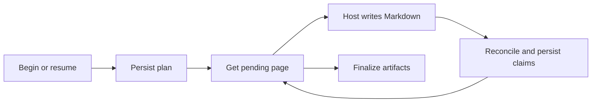

# Native wiki engine and evidence lifecycle

## Ownership and entrypoints

`harlo-wiki` reads, searches, and writes OpenWiki-format repository wikis natively. It is a Rust port of OpenWiki's behavior and authoring instructions, with attribution in `THIRD-PARTY-NOTICES.md` and `crates/harlo-wiki/LICENSE-OPENWIKI`. Compatibility is the implementation's intent; it is not a claim that every upstream behavior has been independently verified.

The boundary above the engine is [core's OpenWiki integration](../integrations/openwiki.md): local calls execute in the desktop process; SSH calls execute through `harlo-agent wiki` on the repository's machine. The engine itself owns tool validation, retrieval, evidence resolution, page state, and finalization. It does not choose a model or generate prose: the host agent researches and writes the assigned page.

`tools.json` supplies the ten tool definitions. Four tools only read: search, section read, workspace listing, and wiki listing. Six tools drive authoring. The MCP adapter offers only reading tools unless constructed with a writer; its `--write` host mode adds lifecycle tools. Successful tool results contain JSON text plus structured content, while tool failures carry `isError` and an error message.

## Retrieval is a rebuildable view

Search first resolves workspace scope, discovers eligible Markdown pages, and turns their headings and text into section units. It builds an **in-memory SQLite FTS5 index**, not a persistent search database. Ranked matches use title, description, heading, prose, and identifiers. Source-path hints boost already-matching units rather than filtering the search down to those paths; term coverage then precedes weighted BM25 ordering.

The cache is bounded to four wiki-root sets and 32 MiB of indexed page text across them. Each search still reads the current pages and compares their text hashes and lengths. An unchanged collection reuses its index; a changed collection rebuilds it while reusing unchanged pages' parsed units. Large collections can be searched without being retained. This makes edits, additions, and deletions visible without a separate reindex command.

Search results are compact references such as `openwiki/architecture/wiki-engine.md#retrieval-is-a-rebuildable-view`. Read resolves the requested wiki, validates the page and anchors, reparses headings, and returns the complete requested sections. An unknown anchor fails the read instead of returning an unrelated passage. Hidden path components are rejected. Optional provenance exposes recorded source resources and claim evidence versions; it does not establish that the claims are fresh or semantically correct.

### Linked workspace scope

An unregistered repository searches only itself. A repository belonging to one workspace searches that workspace automatically. With multiple memberships, an explicit workspace or saved active workspace resolves scope; otherwise search returns `workspace_required` with choices. Treat that as a selection request, not an empty result.

Cross-wiki reads require a registered wiki reachable through a shared workspace. Before using a linked location, the engine verifies its canonical root, Git marker, and wiki update marker. A stale registry location fails rather than silently indexing a different directory. Listing and reading are distinct: a wiki ID is not permission to read an arbitrary repository.

## Durable authoring is a separate state machine



Begin captures source state, language, previous update information, and generated-provenance snapshots. `.run.json` keeps the durable run and queue. A writer object holds at most one active run and rejects later lifecycle calls for a different run ID. Restarted hosts must call begin to rehydrate the durable run before submitting more work.

On resume, a mode or language conflict is refused. If the source fingerprint changed, the persisted run returns to planning and its old plan is removed. Otherwise persisted completion records are reconciled and the run continues. Updates can return `noop` only when the update preflight, claim health, coverage, and stable source checks permit it.

Plan validation canonicalizes paths, rejects reserved pages and duplicate jobs, prohibits deleting quickstart, and requires quickstart for initialization. Unless explicitly deferred, update plans automatically include pages with stale or unresolved evidence. The queue sorts page paths with quickstart last. The host should consume one assigned page at a time, even though pending-job validation itself checks job identity and status rather than enforcing the host's entire research workflow.

### Sparse decisions preserve claim identity

For each existing claim, the host can confirm, revise using its ID, or retract. Issue-free claims omitted from a submission are confirmed automatically; stale or unresolved claims require an explicit decision. New material propositions are added without IDs, which the engine allocates globally. Duplicate decisions for one ID are refused. Every completed factual page must retain at least one claim.

Submitting a page reads the written Markdown, repairs/validates frontmatter, reconciles evidence, and persists claims. Completion is recorded only after durable checks verify the Markdown hash, claim set, and projected verification event agree. Merely writing the page or marking a chat finished does not complete its job.

## Evidence freshness and safety

Evidence uses `repo://` resources with optional positive, ordered line ranges. Git metadata and generated wiki output are not evidence sources. The resolver applies ignore rules before reading, requires a regular repository-contained file, and rejects leaf symlinks and paths whose physical location traverses aliases or symlinked directories.

Whole-file evidence is content-hashed. Line evidence records the selected text hash and boundary/context metadata. Resolution first checks the original range, then looks for a uniquely matching moved span; surrounding context disambiguates duplicates and can locate a changed span. A line-number shift alone therefore need not make evidence stale. Missing or ambiguous evidence becomes unresolved; a changed resolved version becomes stale.

Preflight treats security-refused evidence and evidence newly excluded by ignore rules as unresolved debt rather than aborting the whole run. Other resolution errors still propagate. This recovery path does not authorize reading an excluded resource: remove the unsupported assertion or ground it in permitted current evidence.

The authoring filesystem backend permits ordinary writes only under `/openwiki/`, refuses implementation-owned claim paths, checks ignore rules, and guards containment and symlink writes. Claim sidecars use a dedicated store with canonical-path checks and atomic temporary-file replacement. These engine guards do not sandbox the host agent's own shell or file tools; host authoring instructions remain essential.

## Finalization and failure recovery

Finish refuses pending jobs. It removes planned deletions and abandoned newly created pages, cleans orphaned claim state, then finalizes diagrams, generated indexes, links, source projections, and generated provenance. Claim finalization rechecks evidence, writes sidecars, synchronizes verification frontmatter, and refreshes page hashes. Durability failures are errors, not a successful verification stamp.

Deferred claim pages keep the last-update status interrupted. Source changes detected around finish also leave interrupted freshness metadata, even when the lifecycle result reports completion with `sourceChanged: true`. Distinguish successful artifact finalization from proof that all current source is covered; use a subsequent update for remaining drift.

When changing this system, preserve the separation between disposable retrieval caches and durable authoring state. Changes to evidence formats must account for previously persisted versions; changes to schema or result shape must account for both direct local calls and the MCP adapter. Do not repair state by hand-editing claims or run metadata.

## Focused verification

Representative engine tests cover cache invalidation (`kept_index_follows_the_pages`), evidence canonicalization and moved ranges (`resources`, `ranges_follow_moved_lines`), safe storage, schema validation, and link/diagram processing. Core integration tests additionally exercise local reading without a server and native writer run-ID rejection.

```sh
cargo test -p harlo-wiki
cargo test -p harlo-core --no-default-features openwiki
```

These are suggested focused checks, not a statement that this wiki update executed them. For deployment and wider release verification, see [testing and releases](../operations/testing-and-releases.md); for session routing and desktop update offers, see [OpenWiki integration](../integrations/openwiki.md).
