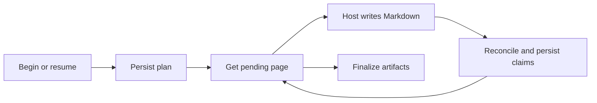

# Native wiki engine and evidence lifecycle

## Ownership and entrypoints

`harlo-wiki` reads, searches, and writes OpenWiki-format repository wikis natively. It is a Rust port of OpenWiki's behavior and authoring instructions, with attribution in `THIRD-PARTY-NOTICES.md` and `crates/harlo-wiki/LICENSE-OPENWIKI`. Compatibility is the implementation's intent; it is not a claim that every upstream behavior has been independently verified.

The boundary above the engine is [core's OpenWiki integration](../integrations/openwiki.md): local calls execute in the desktop process; SSH calls execute through `harlo-agent wiki` on the repository's machine. The engine itself owns tool validation, retrieval, evidence resolution, page state, and finalization. It does not choose a model or generate prose: the host agent researches and writes the assigned page.

`tools.json` supplies the ten tool definitions. Four tools only read: search, section read, workspace listing, and wiki listing. Six tools drive authoring. The MCP adapter offers only reading tools unless constructed with a writer; its `--write` host mode adds lifecycle tools. Successful tool results contain JSON text plus structured content, while tool failures carry `isError` and an error message.

## Retrieval is a rebuildable view

Search first resolves workspace scope, discovers eligible Markdown pages, and turns their headings and text into section units. It builds an **in-memory SQLite FTS5 index**, not a persistent search database. Ranked matches use title, description, heading, prose, and identifiers. Source-path hints boost already-matching units rather than filtering the search down to those paths; term coverage then precedes weighted BM25 ordering.

The cache is bounded to four wiki-root sets and 32 MiB of indexed page text across them. Each search still reads the current pages and compares their text hashes and lengths. An unchanged collection reuses its index; a changed collection rebuilds it while reusing unchanged pages' parsed units. Large collections can be searched without being retained. This makes edits, additions, and deletions visible without a separate reindex command.

Concurrent searches of the same retained scope share a mutex-protected index slot. Building and ranking use that scope's single SQLite connection serially: the first search builds a cold or changed index, and waiting searches with the same page snapshot reuse it. The global cache lock is only for slot selection and eviction, not the whole search. Parsing changed pages can use up to eight workers, bounded further by available parallelism and changed-text size. A failed rebuild returns an error without replacing the previous index; it does not silently serve the previous results for changed content.

Search results are compact references such as `openwiki/architecture/wiki-engine.md#retrieval-is-a-rebuildable-view`. Read resolves the requested wiki, validates the page and anchors, reparses headings, and returns the complete requested sections. An unknown anchor fails the read instead of returning an unrelated passage. Hidden path components are rejected. Optional provenance exposes recorded source resources and claim evidence versions; it does not establish that the claims are fresh or semantically correct.

### Markdown limits isolate failure

Retrieval's Markdown lexer grows its stack as needed and applies three parsing budgets: 3,000 nesting levels, 16 MiB of cumulative work, and 1,048,576 closing-delimiter scans for emphasis and strikethrough. Work counts text again at each nested level and the remaining inline text at each rule-attempt position, so it is not a 16 MiB file-size allowance. The scan budget separately bounds repeated searches for closing `*`, `_`, and `~` delimiters. Exceeding a budget produces `TooDeep` rather than continuing pathological parsing or exhausting the worker thread's stack. Stack-aware inline traversal and token cleanup also protect deeply nested intermediate structures.

Search propagates a parse failure from any page it must index; section read propagates a failure from its requested page. The tool boundary reports `OpenWiki MCP operation failed.` for this error. It is a failed call, not an empty match set or a process-wide shutdown: a subsequent read of another valid page can still succeed. Desktop page presentation uses core's separate Markdown renderer, so successful display is not proof that retrieval accepts the same nesting.

### Linked workspace scope

An unregistered repository searches only itself. A repository belonging to one workspace searches that workspace automatically. With multiple memberships, an explicit workspace or saved active workspace resolves scope; otherwise search returns `workspace_required` with choices. Treat that as a selection request, not an empty result.

Cross-wiki reads require a registered wiki reachable through a shared workspace. Before using a linked location, the engine verifies its canonical root, Git marker, and wiki update marker. A stale registry location fails rather than silently indexing a different directory. Listing and reading are distinct: a wiki ID is not permission to read an arbitrary repository.

## Durable authoring is a separate state machine



Begin captures source state, language, previous update information, and generated-provenance snapshots. `.run.json` keeps the durable run and queue. A writer object holds at most one active run and rejects later lifecycle calls for a different run ID. Restarted hosts must call begin to rehydrate the durable run before submitting more work.

Begin also checks that the wiki folder and code-mode setup destinations resolve inside the canonical repository. Setup covers the managed instruction files and, on initialization, the workflow destination. A destination or parent symlink leading outside is refused, including a dangling link to an outside file; links resolving inside remain supported. This setup containment check is separate from the stricter evidence-file symlink policy below. Correct an outward-pointing link before retrying rather than treating it as a missing writable file.

On resume, a mode or language conflict is refused. Persisted completion records are reconciled before the run continues. If the source fingerprint changed while a plan exists, resume keeps that plan, reopens completed pages whose Claims are now stale or unresolved, and adds newly affected pages unless they are deleted or deferred; unaffected planned pages remain complete. If no plan exists, resume returns to planning. Updates can return `noop` only when the update preflight, claim health, coverage, and stable source checks permit it.

### Model-free update preflight

The desktop can ask `quiet_update` whether an update needs a writing session. It compares the last complete update's commit with the current commit and worktree, then checks page/claim coverage, hand-edited pages, stale cited resources, newly added files, and source files likely to contain material new facts. Added-file checks include committed additions, staged/worktree additions, and untracked files, excluding the wiki, setup files, ignored paths, and files no longer present. Added and grown file lists are prioritized by descending current line count so substantial source appears before assets and license files; supported image/font/lock/JSONL extensions and names containing `LICENSE` receive zero weight, with path ordering breaking ties. For changed source files, a new declaration/key can trigger an update; so can 50 or more added-and-removed diff lines. Definition detection covers keyword declarations at any depth and common method/function forms, while excluding test paths for smaller declaration-only changes. Small edits to uncited code do not by themselves start a model run.

The check is deliberately conservative when Git cannot produce a trustworthy change list: it asks for a model-backed update rather than recording a clean result. It snapshots source before checking and verifies that snapshot again around claim finalization and manifest/update recording, so concurrent code changes remain for a later check. When nothing needs rewriting, it reanchors claims and records the update at the checked commit without starting a session. The large-update detector is a heuristic for likely wiki-relevant changes, not a semantic proof that every code fact is unchanged.

When another preflight condition already requires a model-backed update and claims are readable, `quiet_update` also supplies an `uncovered` research hint: committed source files with no Claim citation, at least 300 lines long, sorted largest first. With a recorded wiki history, the candidates are files added since the commit that first recorded wiki updates; if that history is absent, tracked files are considered. Test, fixture, vendored, setup, ignored, and wiki paths are excluded. This hint is included in the update prompt (up to 15 paths), but uncovered code alone never triggers a writing session. Newly added and grown paths are separately listed by current size, with supported image/font/lock/JSONL files and `LICENSE` names assigned zero weight so source is considered first.

The detector's definition heuristic is intentionally broader than exported API names: it recognizes keyword declarations at any nesting depth, newly introduced keys, and common method/function declarations inferred from changed-line runs in supported source extensions. It compares added and removed names so a pure rename-away does not count as a surviving new fact; for test paths, declaration-only changes are ignored, while the 50-line change threshold still applies. Git output is parsed with controlled diff options and NUL-delimited file lists so unusual filenames or user diff settings do not silently turn an unobserved source change into a clean result. If Git cannot reliably list additions or diffs, the preflight asks for an update instead of treating uncertainty as a clean result. This remains a trigger heuristic: once a run starts, the writing agent still decides which pages actually need edits.

The uncovered-code hint is a catch-up mechanism, not a coverage alarm: it names sufficiently large, uncited source files added since the first recorded wiki update (or tracked source files when no update history exists), and excludes files already decided in a previous run. `submit_plan` must explicitly account for every hint path by placing it under a planned page's seed path or `leaveUncovered`; omitted files make the plan invalid. This lets a later run reconsider missed features without repeatedly prompting on files the writer already assessed.

Plan validation canonicalizes paths, rejects reserved pages and duplicate jobs, prohibits deleting quickstart, and requires quickstart for initialization. Unless explicitly deferred, update plans automatically include pages with stale or unresolved evidence; required rewrite pages (for edited or language-changed pages) are also added unless planned or deleted. The queue sorts by canonical path, with quickstart last. The host should consume one assigned page at a time, even though pending-job validation itself checks job identity and status rather than enforcing the host's entire research workflow.

Page submission has a durability boundary: the assigned Markdown must exist and pass frontmatter validation/repair, Claims are reconciled and finalized, then the engine verifies persisted Claim IDs/statements/evidence against the current page hash and projected verification event before recording completion. Finish is refused while jobs remain or skipped jobs lack their original snapshots; after artifact and Claim finalization it marks metadata interrupted if deferred claim pages remain or source changed across the run. A successful lifecycle response can therefore coexist with an interrupted freshness status when further reconciliation is needed.

### Formats and compatibility helpers

The checked-in tool definition set is the schema source for the four read tools and six authoring tools. Input validation applies the declared types, bounds, required keys and enumerations and reports structured errors; tool answers consistently separate successful structured results from host-facing error text. `okf` owns the knowledge-format frontmatter boundary: validation and deterministic repair operate on producer fields while generated verification/provenance fields are managed during finalization. `lang_data` supplies the supported-language catalog used by language resolution and retrieval labels, while the small JavaScript-compatibility helpers keep ported string/path behavior consistent with the upstream format. These support files are part of the native engine contract, not separate runtime services.

### Sparse decisions preserve claim identity

For each existing claim, the host can confirm, revise using its ID, or retract. Issue-free claims omitted from a submission are confirmed automatically; stale or unresolved claims require an explicit decision. New material propositions are added without IDs, which the engine allocates globally. Duplicate decisions for one ID are refused. Every completed factual page must retain at least one claim. These rules keep claim identity stable while ensuring a page's prose cannot silently leave source issues unresolved.

Submitting a page reads the written Markdown, repairs/validates frontmatter, reconciles evidence, and persists claims. Completion is recorded only after durable checks verify the Markdown hash, claim set, and projected verification event agree. Merely writing the page or marking a chat finished does not complete its job.

## Evidence freshness and safety

Evidence uses `repo://` resources with optional positive, ordered line ranges. Git metadata and generated wiki output are not evidence sources. The resolver applies ignore rules before reading, requires a regular repository-contained file, and rejects leaf symlinks and paths whose physical location traverses aliases or symlinked directories.

Whole-file evidence is content-hashed. Line evidence records the selected text hash and boundary/context metadata. Resolution first checks the original range, then looks for a uniquely matching moved span; surrounding context disambiguates duplicates and can locate a changed span. A line-number shift alone therefore need not make evidence stale. Missing or ambiguous evidence becomes unresolved; a changed resolved version becomes stale.

Preflight treats security-refused evidence and evidence newly excluded by ignore rules as unresolved debt rather than aborting the whole run. Other resolution errors still propagate. This recovery path does not authorize reading an excluded resource: remove the unsupported assertion or ground it in permitted current evidence.

The authoring filesystem backend permits ordinary writes only under `/openwiki/`, refuses implementation-owned claim paths, checks ignore rules, and guards containment and symlink writes. Claim sidecars use a dedicated store with canonical-path checks and atomic temporary-file replacement. These engine guards do not sandbox the host agent's own shell or file tools; host authoring instructions remain essential.

## Finalization and failure recovery

Finish refuses pending jobs. It removes planned deletions and abandoned newly created pages, cleans orphaned claim state, then finalizes diagrams, generated indexes, links, source projections, and generated provenance. Claim finalization rechecks evidence, writes sidecars, synchronizes verification frontmatter, and refreshes page hashes. Durability failures are errors, not a successful verification stamp.

Deferred claim pages keep the last-update status interrupted. Source changes detected around finish also leave interrupted freshness metadata, even when the lifecycle result reports completion with `sourceChanged: true`. Distinguish successful artifact finalization from proof that all current source is covered; use a subsequent update for remaining drift.

When changing this system, preserve the separation between disposable retrieval caches and durable authoring state. Changes to evidence formats must account for previously persisted versions; changes to schema or result shape must account for both direct local calls and the MCP adapter. Do not repair state by hand-editing claims or run metadata.

## Focused verification

Representative engine tests cover cache invalidation (`kept_index_follows_the_pages`), evidence canonicalization and moved ranges (`resources`, `ranges_follow_moved_lines`), safe storage, schema validation, and link/diagram processing. Core integration tests additionally exercise local reading without a server and native writer run-ID rejection.

The model-free preflight tests (`quiet_updates`, `quiet_updates_miss_nothing`) cover cited-line movement versus changes, uncited small edits versus substantial/new declarations, added and untracked files, hand-edited pages, incomplete claims, active runs, Git settings and unusual paths, Git failures, and source changing during the check. `changed_files_are_listed_heaviest_first` checks the size ordering and zero-weight asset/license behavior; `the_largest_code_no_page_cites_is_named_when_a_model_is_needed` checks that the uncovered hint is emitted only alongside another update reason and excludes old code, small files, tests, vendored/minified files, and pictures. These tests exercise the detector's conservative boundaries; they do not prove it can decide semantic documentation relevance without a model.

`concurrent_searches_share_the_index` verifies four simultaneous cold searches build one index and warm searches reuse it. `deep_nesting_fails_the_text_not_the_process` exercises the lexer on a 256 KiB thread stack, including accepted nesting and rejected depth/work cases. `setup_stays_inside_the_repository` checks outward file, parent-directory, wiki-directory, and dangling links as well as supported inward links. Core's `deep_page_fails_its_calls_only` verifies that search and read fail without preventing a subsequent valid read; `deep_pages_view_on_a_small_stack` covers the separate desktop rendering path.

`delimiter_runs_stop_at_their_budget` checks that large mixed-delimiter headings and repeated `_a` headings fail with `TooDeep` within a bounded elapsed time, while smaller examples and headings with lone delimiters still parse. Together with the small-stack test, it covers expensive inline parsing as well as deeply nested blocks; a page need not exceed the nesting limit to be refused.

```sh
cargo test -p harlo-wiki
cargo test -p harlo-core --no-default-features openwiki
```

These are suggested focused checks, not a statement that this wiki update executed them. For deployment and wider release verification, see [testing and releases](../operations/testing-and-releases.md); for session routing and desktop update offers, see [OpenWiki integration](../integrations/openwiki.md).
