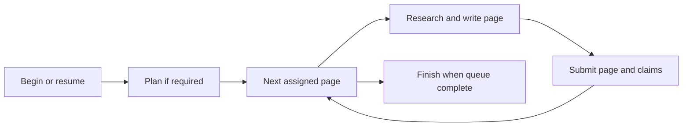

# OpenWiki integration and wiki lifecycle

## Runtime ownership

`harlo-core::openwiki` is the integration boundary; OpenWiki itself is a bundled Node package rather than a Rust reimplementation of its generation engine. The shipped layout is `lib/harlo/openwiki`, containing Node and the pinned package. Runtime discovery also supports development layouts and the `HARLO_OPENWIKI` override, which must point to a usable runtime.

On first use, core starts `node …/cli.js mcp --host harlo` and caches a live server per machine. Dead servers are removed before reuse. Remote repositories use the server on their SSH host, after putting the appropriate runtime in that host's cache. This follows [remote-machine](remote-machines-and-models.md) routing rather than trying to index remote files with a local path.

Telemetry defaults off. The integration sets `OPENWIKI_TELEMETRY_DISABLED=1` and `DO_NOT_TRACK=1`; changing the user setting stops cached servers so their replacements inherit the new environment.

## Session-scoped tools

Ordinary wiki-enabled sessions receive `openwiki_search` and `openwiki_read`. Search returns ranked section references; read fetches the selected sections. They are retrieval operations, not generation requests. The installed instruction encourages retrieval only for concrete unfamiliar questions and treats wiki results as leads to verify against source.

Wiki-writing sessions additionally receive six lifecycle tools from the server's own schemas: begin, submit plan, next page, inspect claims, submit page, and finish. Harlo removes `root` from offered schemas. At dispatch it derives the session repository, splits remote paths into host and real path, and injects `root` only if that tool's server schema accepts it. Later lifecycle calls can operate by run/job ID alone.

Calls have bounded waits: 90 seconds for read tools and 600 seconds for writing tools. A failure is not permission to fabricate a successful lifecycle result.

## Generation flow



Harlo constructs the first prompt for create, update, or continue and appends the bundled OpenWiki skill's required sequence. Continuation calls begin again with the interrupted run's mode and proceeds from its durable queue. The prompt explicitly restricts the session to wiki work and says not to resolve or supply the root itself.

Before starting that session, the desktop reads the repository's `.openwikiignore` through core. Blank lines and comments are omitted; unreadable or missing files yield no rules. When rules exist, the prompt lists them and prohibits reading, searching, running, citing, or describing excluded resources. Updates must plan every existing page mentioning them and remove that material. This instruction matters because the host agent researches with its own tools, outside OpenWiki's evidence resolver.

The bundled package also carries an excluded-evidence preflight patch: an evidence-resolution error specifically identifying a path excluded by `.openwikiignore` is handled like a refused security resource, allowing reconciliation as unresolved evidence instead of aborting the run. Other resource errors still propagate. An unresolved claim is work to reconcile, not permission to read the excluded source or automatically retain its assertion.

The package's lifecycle tools own queue state and claim reconciliation. The host agent writes the assigned Markdown and submits evidence through those tools; generated indexes, claim sidecars, and run metadata are not ordinary authoring targets. Details of validation belong to the bundled OpenWiki version, not to a parallel Rust validator.

One integration-specific cleanup matters operationally: after an `openwiki_finish` call, Harlo removes a newly generated, untracked `.github/workflows/openwiki-update.yml`. A tracked workflow is preserved. This avoids opting the repository into automatic API-key-funded updates merely by creating a wiki; do not confuse this cleanup with user-requested source changes.

## Update offers after default-branch changes

The desktop checks local wiki-enabled projects after startup and then every minute. It offers an update rather than starting generation automatically. Core resolves the default branch from `origin/HEAD`, falling back to local `main` or `master`, and examines its local branch tip against the last wiki update. The checkout must already contain that tip. A pending or interrupted wiki run suppresses the offer in favor of continuation.

An offer requires new commits affecting files cited by page provenance or claims; wiki-only and agent-instruction-only changes are excluded from the counted history. The displayed commit count covers the qualifying history, not just commits touching cited files. Uncited changes alone do not trigger an offer. This is a targeted reminder, not a complete freshness audit.

Accepting or declining records the tip in the project's `wiki_seen_<id>` setting and removes the offer until the branch moves again. Accepting invokes the ordinary update-session path; it does not bypass runtime checks or the durable queue. Remote projects are not polled for these offers.

## Browsing without the tool runtime

The desktop can still read Markdown frontmatter, page links, `.run.json` progress, `.last-update.json` freshness, and plain-text section search without Node. Generated `index.md`, `log.md`, and `INSTRUCTIONS.md` are not treated as independent ordinary pages. Quickstart sorts first. This lightweight browser is distinct from the OpenWiki server's richer retrieval and generation operations.

The same exclusion of generated page names applies inside subfolders, both in page listings and lightweight search. The safe page reader rejects parent traversal and hidden claim paths. Provenance and claims can be presented through dedicated parsing helpers instead of exposing arbitrary files as pages.

## Extension and verification

`packaging/openwiki/fetch.sh` applies bundled patches after installing the pinned package and fails if a patch cannot apply. Its runtime `VERSION` identity includes a hash of patch contents as well as the package lock and Node version, so changing a patch invalidates reuse of a previously prepared runtime.

Keep server schemas authoritative when adding lifecycle tools, and preserve caller-derived root selection. Cross-machine changes need both runtime deployment and the remote command path checked; local browsing alone does not demonstrate that remote tool execution works.

Focused tests in `openwiki.rs` cover page/link order, rejected reads, durable-state/progress parsing, section search, response normalization, and the absence of `root` in offered retrieval schemas:

`merged_code_the_wiki_cites_offers_an_update` additionally exercises cited versus uncited changes, already-seen tips, checkouts missing the new work, and suppression during a run.

```sh
cargo test -p harlo-core --no-default-features openwiki
```

For how these tools reach agents, continue to [plans and orchestration](../workflows/plans-and-project-changes.md).
