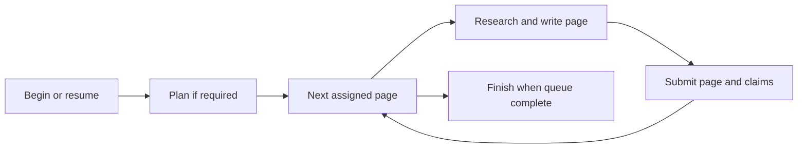

# OpenWiki integration and wiki lifecycle

## Native ownership and machine routing

`harlo-core::openwiki` is the integration boundary; `harlo-wiki` is the native Rust engine for OpenWiki-format retrieval and generation. Local reading tools execute directly in process. Local writing uses a mutex-protected writer cached per repository path, so each repository has its own active authoring run. There is no Node runtime to discover or install for these calls.

Remote repositories use `harlo-agent wiki` on their SSH host. Core obtains or deploys that agent through the normal agent-host path, starts its stdio MCP endpoint, and caches live readers per host. Writers use `wiki --write harlo` and are cached per host and repository; dead processes are discarded before reuse. This follows [remote-machine](remote-machines-and-models.md) routing rather than trying to index remote files with a local path.

The desktop no longer gates wiki creation on a separately discovered runtime. Before starting a remote writing session, it prepares that repository's writer endpoint, so an unavailable remote agent is reported before the session begins. Local preparation needs no server startup. See the [native wiki engine](../architecture/wiki-engine.md) for search caching, evidence safety, and durable state ownership.

## Session-scoped tools

Ordinary wiki-enabled sessions receive `openwiki_search` and `openwiki_read`. Search returns ranked section references; read fetches the selected sections. They are retrieval operations, not generation requests. The installed instruction encourages retrieval only for concrete unfamiliar questions and treats wiki results as leads to verify against source.

Wiki-writing sessions additionally receive six lifecycle tools from the native engine's definitions: begin, submit plan, next page, inspect claims, submit page, and finish. The engine also supports listing workspaces and wikis, but Harlo normally offers just search/read to keep the tool set small; search itself returns workspace choices when selection is required. Harlo removes `root` from offered schemas. At dispatch it derives the session repository, splits remote paths into host and real path, and injects `root` only if that tool's definition accepts it. Later lifecycle calls operate by run/job ID alone; an unwanted caller-supplied `root` is removed from those arguments.

Remote calls have bounded waits: 90 seconds for read tools and 600 seconds for writing tools. Local calls invoke the native implementation directly rather than waiting on MCP. A failure is not permission to fabricate a successful lifecycle result.

## Generation flow



Harlo constructs the first prompt for create, update, or continue and appends the authoring sequence embedded in `harlo-wiki::AUTHORING`. Continuation calls begin again with the interrupted run's mode and proceeds from its durable queue. The prompt explicitly restricts the session to wiki work and says not to resolve or supply the root itself. That root shortcut is specific to Harlo's session adapter, which fills it in; it is not a rule for every external OpenWiki host.

Before starting that session, the desktop reads the repository's `.openwikiignore` through core. Blank lines and comments are omitted; unreadable or missing files yield no rules. When rules exist, the prompt lists them and prohibits reading, searching, running, citing, or describing excluded resources. Updates must plan every existing page mentioning them and remove that material. This instruction matters because the host agent researches with its own tools, outside OpenWiki's evidence resolver.

The native engine's claim preflight handles evidence excluded by `.openwikiignore` like a refused security resource, allowing reconciliation as unresolved evidence instead of aborting the run. Other resolution errors still propagate. An unresolved claim is work to reconcile, not permission to read the excluded source or automatically retain its assertion.

The engine's lifecycle tools own queue state, frontmatter validation, evidence versions, and claim reconciliation. The host agent writes the assigned Markdown and submits evidence through those tools; generated indexes, claim sidecars, and run metadata are not ordinary authoring targets. The [engine architecture](../architecture/wiki-engine.md#durable-authoring-is-a-separate-state-machine) distinguishes durable page completion from a session simply ending.

One integration-specific cleanup matters operationally: after an `openwiki_finish` call, Harlo removes a newly generated, untracked `.github/workflows/openwiki-update.yml`. A tracked workflow is preserved. This avoids opting the repository into automatic API-key-funded updates merely by creating a wiki; do not confuse this cleanup with user-requested source changes.

## Update offers after default-branch changes

The desktop checks local wiki-enabled projects after startup and then every minute. It offers an update rather than starting generation automatically. Core resolves the default branch from `origin/HEAD`, falling back to local `main` or `master`, and examines its local branch tip against the last wiki update. The checkout must already contain that tip. A pending or interrupted wiki run suppresses the offer in favor of continuation.

An offer requires new commits affecting files cited by page provenance or claims; wiki-only and agent-instruction-only changes are excluded from the counted history. The displayed commit count covers the qualifying history, not just commits touching cited files. Uncited changes alone do not trigger an offer. This is a targeted reminder, not a complete freshness audit.

Accepting or declining records the tip in the project's `wiki_seen_<id>` setting and removes the offer until the branch moves again. Accepting invokes the ordinary update-session path; it does not bypass session preparation or the durable queue. Remote projects are not polled for these offers.

## Browsing and search fallback

The desktop reads Markdown frontmatter, page links, `.run.json` progress, and `.last-update.json` freshness directly from repository files. Generated `index.md`, `log.md`, and `INSTRUCTIONS.md` are not treated as independent ordinary pages. Quickstart sorts first. This lightweight browser is distinct from the native engine's ranked retrieval and generation operations.

Panel search first calls ranked `openwiki_search`. If that fails, it returns a plain-text section search marked `plain`, with no workspace choices. This is a fallback, not equivalent workspace-wide retrieval: for example, a remote host may allow reading page files even when the wiki agent cannot run there.

The same exclusion of generated page names applies inside subfolders, both in page listings and lightweight search. The safe page reader rejects parent traversal and hidden claim paths. Provenance and claims can be presented through dedicated parsing helpers instead of exposing arbitrary files as pages.

The desktop freshness footer distinguishes planning, writing-page counts, interrupted runs, and last-update age/commit distance. It lays out freshness phrases separately so narrow panels wrap between phrases, then between words when a phrase exceeds the panel width; this presentation does not change the durable run state.

For desktop session organization, see [finished wiki sessions](../architecture/sessions-and-desktop.md#finished-wiki-sessions-and-approval-presentation). Diagnose lifecycle completion from the durable run, not merely from where its chat appears in the sidebar.

## Extension and verification

Keep native engine definitions authoritative when adding lifecycle tools, and preserve caller-derived root selection. Cross-machine changes need both agent deployment and the remote command path checked; local browsing alone does not demonstrate that remote tool execution works. The desktop's state response retains a `runtime: true` compatibility field, which phones interpret as `canWrite`; it is no longer a runtime-discovery result.

Focused tests in core's `openwiki.rs` cover page/link order, rejected reads, durable-state/progress parsing, section search, response normalization, and the absence of `root` in offered schemas. `reading_needs_no_openwiki` verifies local ranked reading without starting a server, and `writing_runs_here` exercises native begin persistence and rejection of an unmatched run ID.

`merged_code_the_wiki_cites_offers_an_update` additionally exercises cited versus uncited changes, already-seen tips, checkouts missing the new work, and suppression during a run.

```sh
cargo test -p harlo-core --no-default-features openwiki
```

For how these tools reach agents, continue to [plans and orchestration](../workflows/plans-and-project-changes.md).
