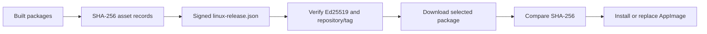

# Testing, packaging, and signed updates

## Build and isolate development

The contributor guide documents Rust 1.85+, Qt 6.9+ (base, declarative, multimedia), cmake, and clang. Use the current stable Rust toolchain and the repository lockfile when diagnosing dependency/toolchain compatibility; documented minima are not a guarantee that every later locked dependency builds with an older compiler. Dictation includes whisper.cpp, so even the Rust workspace has native build requirements.

```sh
cargo run -p harlo-app --release
cargo test --workspace
cargo clippy --workspace --all-targets
# Core logic without whisper.cpp's optional dictation feature:
cargo test -p harlo-core --no-default-features
# Headless model-server helper:
cargo build -p harlo-core --release --bin harlo-engines --no-default-features
```

Use a scratch HOME or XDG data/config directories for interactive testing. Demo sessions stream synthetic events without an installed agent or model credits. Demo verifies presentation and session plumbing, not a real provider, sandbox, or authentication flow.

## Choose tests by boundary

| Change | Start with | Then verify |
| --- | --- | --- |
| Wire translation or framing | `cargo test -p harlo-harness` | Real/scripted agent protocol integration |
| Session reduction or metadata | Focused core tests | Demo subscriber lifecycle and UI behavior |
| Sandbox or agent tools | `cargo test -p harlo-agent` | Actual OS sandbox behavior |
| Phone protocol | Core phone tests, `swift test --package-path ios/HarloKit` | Direct and relay transport behavior |
| OpenWiki integration | Core `openwiki` test filter | Bundled runtime and remote tool-server behavior |
| Packaging/update | Signing/core update tests | Installed package smoke tests and self-update scenario |

Keep external-service checks distinct from hermetic unit tests. See [agent safety](../concepts/agent-execution-and-safety.md) and [phone integration](../integrations/phone-and-relay.md) for focused invariants.

For stream-accounting regressions, start narrowly before running the broader agent suite:

```sh
cargo test --locked -p harlo-agent a_stream_that_breaks_keeps_what_it_said_it_used
cargo test --locked -p harlo-agent a_later_report_of_part_keeps_the_rest
cargo test --locked -p harlo-agent each_count_said_is_kept_on_its_own
cargo test --locked -p harlo-agent each_try_is_counted_as_it_ends_and_the_next_admitted
```

The partial-count check distinguishes output-only and input-only reports from measured zero, including budget-only estimation of missing input. The attempt-accounting check covers charging before retry admission and dropping an in-flight request after it has reported usage: the spend remains, the hold is released, and an empty snapshot does not add another charge. These unit boundaries complement the broken-stream and report-merging checks; they are not a claim that every provider's cancellation behavior has been tested.

For phone code display/copy regressions, use the focused checks listed in [phone verification](../integrations/phone-and-relay.md#verification); core crypto tests alone are not a substitute for checking desktop serialization and the Swift renderer.

## Headless Rust CI

`.github/workflows/tests.yml` runs the agent and core tests on pushes to `main`, pull requests, and manual dispatch. Push/PR changes confined to iOS, the website, wiki, or Markdown are ignored. Runs for the same ref cancel an older in-progress run.

The job uses Ubuntu 24.04, stable Rust, a Cargo cache, and a 45-minute timeout. It installs native compiler/build dependencies and bubblewrap, then runs:

```sh
cargo test --locked -p harlo-agent -p harlo-core
```

This is not a whole-workspace or Qt UI job. The workflow disables Ubuntu's AppArmor restriction on unprivileged user namespaces on its runner so sandbox tests can execute bubblewrap rather than only checking generated arguments. That runner setup is a prerequisite for exercising the real sandbox boundary, not advice to change a production machine's security policy. Desktop interaction and end-to-end checks remain separate from this job.

## Release production

`docs/releasing.md` describes the maintainer workflow: add the next version's CHANGELOG section, then invoke `packaging/release.sh` from an up-to-date main branch. The script checks repository state, updates Cargo versions, commits, tags and pushes, then follows the release workflow. These are publishing operations, not prerequisites for ordinary development; do not run them merely to test a change. `--dry-run` is the documented preview.

The release workflow builds remote ARM helpers, then Linux packages/AppImage with bundled Qt (currently Qt 6.12.0). Package installation is exercised in Ubuntu 22.04/24.04, Debian 12, Fedora 42, openSUSE Tumbleweed and Arch containers. Publishing depends on both build and install jobs and is restricted to `v*` tags. It verifies that the tag version matches Cargo, extracts release notes, signs the update manifest, and creates the GitHub release. Manual runs and release-check branches can build/test without publishing.

The iPhone app has a separate release/version lifecycle. The website in `site/` is the static download/support surface, not the desktop UI runtime.

Cloudflare Workers static assets serves `site/` directly, with no site build step. `wrangler.jsonc` selects HTML path handling and the custom 404 page and disables workers.dev and preview addresses. The download page obtains current release files from GitHub's API; site deployment is distinct from producing or signing desktop packages.

## Signed self-update trust chain



`harlo-update-signing` defines a shared canonical payload: domain-separated bytes, version/tag/repository, and assets sorted by name, with NUL-delimited fields. The non-shipped `harlo-manifest-signer` holds the private-key signing path; installed Harlo carries the public verification key. The workflow supplies `HARLO_UPDATE_SIGNING_KEY` only to the signing step.

Core verifies the manifest signature before accepting it, then checks repository identity and `v<version>` consistency. The desktop hashes the downloaded asset and refuses installation on mismatch. SHA256SUMS alone is not this trust boundary: an attacker able to replace a package and plain checksum must still satisfy the signed manifest.

`HARLO_UPDATE_PUBLIC_KEY` supports throwaway test keys and is an explicit environment override. Protect the launch environment accordingly. Key rotation also needs planning: installed clients with the old built-in public key cannot accept releases signed only by a new key.

## What this wiki verifies

This wiki was researched from repository files; the suggested build and integration commands are not reported as executed tests. OpenWiki validates page submissions and finalizes its own indexes/provenance separately. Start at the [quickstart](../quickstart.md) to choose a subsystem before running expensive checks.
